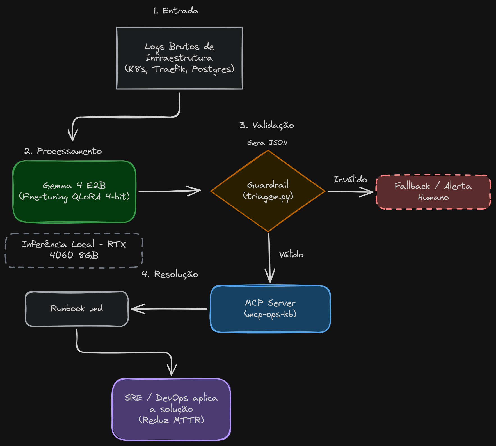

# Agente de Triagem de Incidentes (SRE/DevOps) com Gemma 4 E2B

Este repositório contém o pipeline completo de geração de dados, treinamento (QLoRA) e avaliação de um **agente de triagem determinístico de incidentes**.

O objetivo é receber logs brutos de infraestrutura, identificar a causa raiz e retornar um JSON estruturado indicando o runbook de mitigação correspondente, método de reduzir o MTTR (*Mean Time to Resolution*) de uma gerência proativa.

O projeto foi desenvolvido para executar inteiramente em ambiente local, utilizando uma GPU de consumidor (NVIDIA RTX 4060 com 8 GB de VRAM). Dessa forma, os logs permanecem privados, sem necessidade de envio para APIs externas, e a inferência não gera custos com serviços de terceiros.

> **Modelo treinado (v6) e Model Card disponíveis no Hugging Face:**
>
> [Brunovski/gemma4-e2b-incident-triage](https://huggingface.co/Brunovski/gemma4-e2b-incident-triage)

## Arquitetura

O agente local faz a triagem antes de qualquer escalada. Se a resposta for inválida ou apontar uma resposta inválida ou indique um runbook inexistente, uma camada de *guardrails* intercepta a saída e impede que informações incorretas avancem para as próximas etapas.

Para incidentes mais complexos, o sistema também possui um mecanismo de fallback, preparado para encaminhar a análise a um modelo maior ou a um operador humano.

<p align="center">
  
</p>

## Decisões técnicas

- **Dataset sintético e realista (`gerar_dataset.py`):** geração de 4.000 exemplos, cobrindo 34 classes de incidentes distribuídas em 7 subsistemas, incluindo Traefik, Kubernetes e PostgreSQL. O conjunto contempla *hard negatives* (erros 4xx e warnings) e cascatas de falhas, nas quais o modelo precisa identificar a causa primária em vez de classificar apenas o sintoma final.

- **Otimização para 8 GB de VRAM:** utilização de Unsloth com QLoRA 4-bit, descarte das torres multimodais (`text_only=True`) e `offload_embedding=True`, mantendo o pico de utilização de memória durante o treinamento em aproximadamente 7,1 GB.

- **Guardrail determinístico (`triagem.py`):** validação do campo `runbook` contra um catálogo real de arquivos `.md`. Caso o modelo indique um caminho inexistente, o valor é substituído por `None` antes de chegar ao servidor MCP.

- **Fallback e FinOps (`triagem.py`):** módulo preparado para encaminhar incidentes complexos para APIs de modelos maiores. O processo envia a lista de runbooks válidos e registra a origem da triagem.

- **Avaliação rigorosa:** separação entre conjuntos de treinamento e teste, com avaliação em 300 exemplos sintéticos (incluindo formulações não utilizadas durante o treinamento) e 32 janelas de logs reais coletados em um *chaos lab* baseado em Kubernetes.

##  Estrutura do Repositório

```text
├── runbooks/                  # 34 arquivos .md de procedimentos operacionais
├── triagem.py                 # Inferência, guardrails e fallback
├── gerar_dataset.py           # Gerador de dados sintéticos (SRE)
├── preparar_reais.py          # Parser de logs brutos do chaos lab
├── treino_gemma4.ipynb        # Treinamento (QLoRA + Unsloth)
├── avaliar_reais.ipynb        # Avaliação com logs reais
├── arquitetura.png            # Diagrama de arquitetura
└── requirements.txt           # Dependências do projeto
```

##  Como Executar o Projeto

### 1. Instalação do Ambiente

Recomenda-se utilizar Python 3.12 e um ambiente virtual (`venv` ou `uv`).

```bash
git clone https://github.com/SEU_USUARIO/gemma4-incident-triage.git

cd gemma4-incident-triage

python -m venv .venv

# Linux / macOS
source .venv/bin/activate

# Windows
.venv\Scripts\activate

pip install -r requirements.txt
```

### 2. Geração dos Dados e Treinamento

O treinamento é realizado por meio de um Jupyter Notebook.

```bash
jupyter lab
```

Abra o arquivo `treino_gemma4.ipynb` e execute as células em sequência.

O notebook executará as seguintes etapas:

1. Geração do dataset sintético (`data/treino.jsonl` e `data/teste.jsonl`).
2. Preparação dos logs reais, caso a pasta `logs_raw/` esteja disponível.
3. Treinamento do modelo base `unsloth/gemma-4-E2B-it` utilizando LoRA.
4. Salvamento do adaptador treinado no diretório `gemma4-e2b-incident-triage-v6/`.

### 3. Avaliação e Inferência

Para testar o modelo com novos logs, sem executar novamente o treinamento, utilize o módulo de triagem:

```python
import json
from functools import partial

from unsloth import FastModel
import triagem as tri

# Carrega o modelo treinado
model, tokenizer = FastModel.from_pretrained(
    model_name="gemma4-e2b-incident-triage-v6",
    max_seq_length=2048,
    load_in_4bit=True,
    text_only=True,
    device_map={"": 0},
    offload_embedding=True,
)

FastModel.for_inference(model)

# Inicializa a função de triagem
triagem_fn = partial(tri.triagem, model, tokenizer)

# Exemplo de logs de entrada
log_sujo = """
api-1 | java.sql.SQLTransientConnectionException: HikariPool-1 - Connection is not available
traefik-1 | 504 Gateway Timeout
"""

# Executa a triagem
resultado = triagem_fn(log_sujo)

print(json.dumps(resultado, indent=2, ensure_ascii=False))
```

##  Resultados: v5 vs. v6 em Logs Reais

A versão v6 incorporou classes de incidentes identificadas diretamente no *chaos lab*, incluindo cenários como banco de dados inexistente e problemas de RBAC no Traefik.

A comparação abaixo apresenta a evolução do modelo em relação à versão base (*zero-shot*) e à versão anterior (v5).

| Métrica | Base (Zero-shot) | v5 | v6 (Atual) |
|:--|--:|--:|--:|
| JSON válido | 100% | 100% | **100%** |
| Runbook correto | 0% | 53% | **88%** |
| Severidade correta | 28% | 34% | **94%** |
| Alucinação (inventados) | 100% | 44% | **12%** |

##  Licença

Este projeto utiliza o modelo Gemma 4 e, portanto, está sujeito aos [Termos de Uso do Gemma](https://ai.google.dev/gemma/terms).
